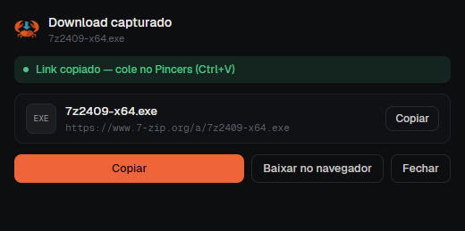
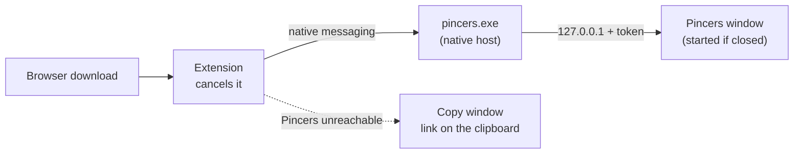

<p align="center">
  
</p>

<h1 align="center">Pincers for browsers</h1>

<p align="center">
  <strong>Sends your browser's downloads to <a href="https://github.com/dazevedogabriel/Pincers">Pincers</a>, the multi-connection download manager written in Rust 🦀</strong>
</p>

<p align="center">
  
  
  
  
</p>



Like IDM's *Integration Module*: when the browser starts downloading a file of
a known type, the extension cancels it and **hands it to Pincers**, with the
page's cookies and referrer so downloads behind a login work too. If Pincers
is closed, it opens.

- **No installer, no PATH.** Browsers start a program only from the location
  it registered, so every time the Pincers window opens it registers its
  *current* location (`HKCU`, no admin rights). Move `pincers.exe` anywhere,
  open it once, and the extension follows it.
- **Nothing gets lost.** If Pincers can't be reached (you moved it and haven't
  opened it yet), the link is **copied to the clipboard** and a
  *Send to Pincers* button retries. Turning off *Start them in Pincers* in the
  popup makes copying the default.
- **Alt+click** a link to let the browser handle that one.
- Right-click → **Download with Pincers**, for a link or for *every* file link
  on the page (or in the selection).
- The popup shows whether Pincers is connected, and lets you choose the file
  types and the sites to ignore.
- Speaks the browser's language: Portuguese and English.

<br clear="right">

## 🚀 Getting started

You need [Pincers](https://github.com/dazevedogabriel/Pincers): open it once so
the browsers can find it. Then build the extension (Windows PowerShell):

```bash
powershell -ExecutionPolicy Bypass -File build.ps1
```

- **Opera GX / Chrome:** `opera://extensions` (or `chrome://extensions`) →
  turn on developer mode → *Load unpacked* → `dist/chrome`.
- **Firefox:** `about:debugging#/runtime/this-firefox` → *Load temporary
  add-on* → `dist/firefox/manifest.json`. Permanent installs need
  `dist/pincers-firefox.xpi` signed (free) on [addons.mozilla.org](https://addons.mozilla.org/developers/).

## 🔌 How it talks to Pincers



The extension speaks [native messaging](https://developer.chrome.com/docs/extensions/develop/concepts/native-messaging)
to the host `com.pincers.host`. Only this extension may start it, so web pages
cannot push downloads into Pincers. Three values tie the two projects
together and must match Pincers' `src/bridge.rs`:

| Here | In Pincers | Value |
|---|---|---|
| `key` in `manifest.chrome.json` (fixes the extension ID) | `CHROME_EXTENSION_ID` | `oogdnhbjgdjaaolpjobohbmhkbjiljla` |
| `browser_specific_settings.gecko.id` in `manifest.firefox.json` | `FIREFOX_ADDON_ID` | `pincers@pincers.app` |
| `HOST` in `src/background.js` | `HOST_NAME` | `com.pincers.host` |

## 🌍 Translations

Texts live in the browsers' standard format,
[`src/_locales/<lang>/messages.json`](src/_locales) (`pt_BR` and `en` today).
The extension follows the browser's language, with English as the fallback.
To add one, copy `_locales/en` to a folder named after the language (`es`,
`fr`, `de`…), translate each `message` and run `build.ps1`: the build stops if
any language is missing a key or has one the extension no longer uses.

## 🗂️ Project layout

```text
pincers-extension/
├── src/
│   ├── background.js      capture, context menus, hand-off to Pincers
│   ├── content.js         Alt+click bypass
│   ├── popup.*            toolbar popup: status and settings
│   ├── captured.*         copy window (when Pincers can't be reached)
│   ├── i18n.js            fills data-i18n attributes from _locales
│   ├── _locales/          pt_BR and en
│   ├── icons/             rendered from assets/logo.svg
│   └── fonts/             Geist and Geist Mono
├── manifest.chrome.json   Manifest V3 (Opera GX, Chrome, Edge, Brave)
├── manifest.firefox.json  Manifest V2 (Firefox)
├── build.ps1              translation check + dist/ packages
└── assets/logo.svg
```

The icons are rendered from the logo by Pincers' `cargo run --release --example extension_icons`.

## 🙏 Credits

- [Geist and Geist Mono](https://vercel.com/font) by Vercel, under the SIL Open Font License.
- Internet Download Manager is a product of Tonec FZE. This extension is an
  independent project, not affiliated with or endorsed by Tonec; no IDM code is included.
